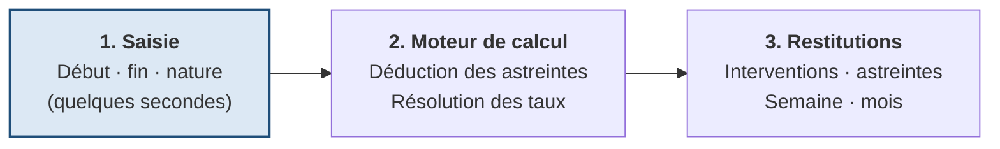
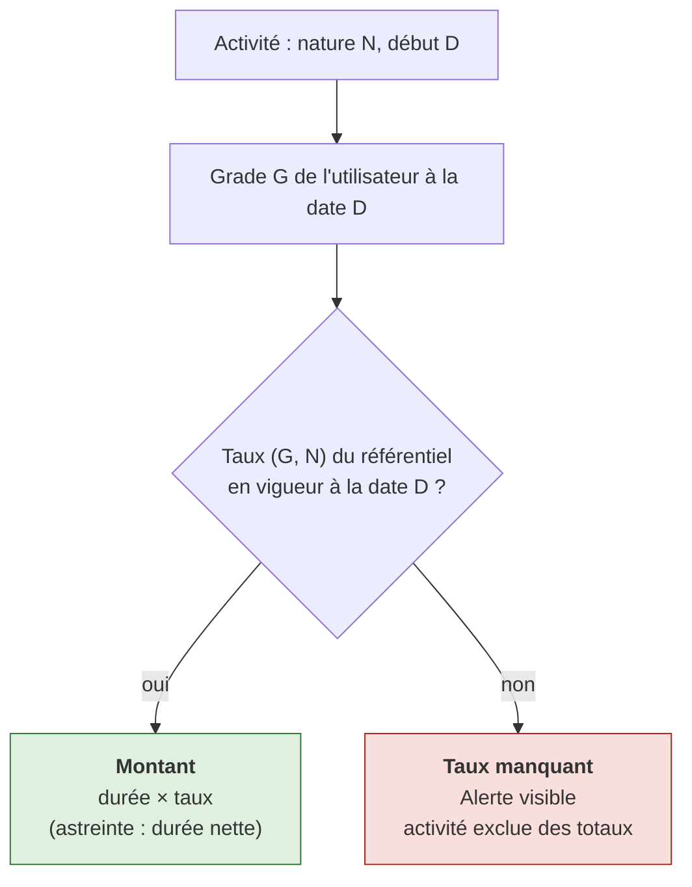
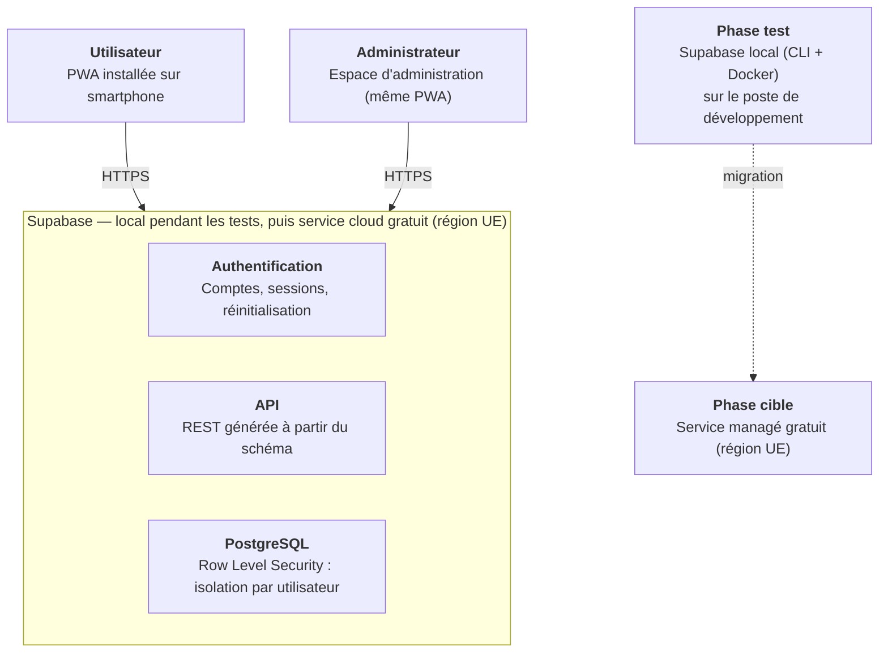
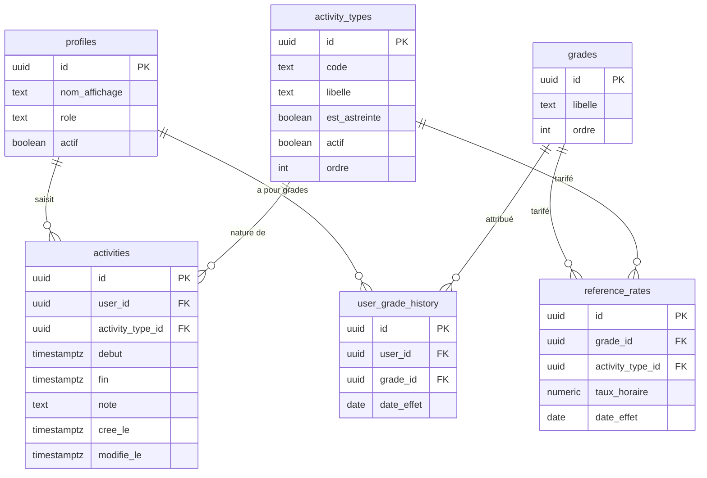
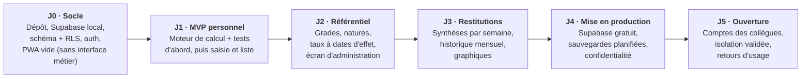

# Cahier des charges — Application PWA de suivi des activités et indemnités des sapeurs-pompiers volontaires

> Saisie minimaliste · calcul automatique des astreintes · rémunération par grade et par nature

| | |
|---|---|
| **Version** | 1.6 |
| **Date** | 13/11/2026 |
| **Statut** | Brouillon à valider |
| **Statut du porteur** | Sapeur-pompier volontaire (SPV) |
| **Destinataire** | Projet de développement (projet Claude et Claude Code) |

> Les montants affichés par l'application sont indicatifs et ne remplacent pas les relevés officiels du SDIS.

**Ce document est la source de référence unique** pour les règles métier, le modèle de données et la stack. Il est complété par le journal des décisions (`docs/decisions.md`), par le fichier d'avancement (`docs/avancement.md`) et par les spécifications des écrans. Toute modification passe par une branche `docs/…` (voir section 12).

## Sommaire

1. Contexte et objectif
2. Périmètre et utilisateurs
3. Besoins fonctionnels
4. Améliorations proposées (hors MVP)
5. Exigences non fonctionnelles
6. Architecture et stack
7. Modèle de données
8. Écrans principaux
9. Critères d'acceptation et tests
10. Plan de livraison
11. Points ouverts à valider
12. Consignes pour l'équipe de développement
13. Historique des versions

---

## 1. Contexte et objectif

Un sapeur-pompier volontaire (SPV) enchaîne des activités de natures différentes (astreintes, interventions, gardes, manœuvres, tâches administratives…), chacune indemnisée selon un taux qui dépend de sa nature et du grade. Le suivi est aujourd'hui fastidieux et peu lisible, notamment pour les astreintes, dont la durée effective doit tenir compte des interventions réalisées pendant leur déroulement.

**Objectif final :** déployer une application web progressive (PWA) installable sur smartphone, qui permet de saisir ses activités en quelques secondes et de visualiser ses heures et ses indemnités calculées automatiquement.

**Principes directeurs :**

- Saisie minimaliste : début, fin, nature. Tout le reste est calculé.
- Calculs fiables, transparents et testés (c'est le cœur de la valeur de l'application).
- Architecture multi-utilisateurs dès la conception, même si l'usage initial est personnel.
- Un référentiel unique et commun : aucun utilisateur ne peut modifier un taux.
- Coûts d'hébergement nuls ou quasi nuls à terme.

*Figure 1 — Vue d'ensemble : de la saisie aux restitutions (l'utilisateur ne renseigne que l'étape 1, tout le reste est calculé)*

## 2. Périmètre et utilisateurs

**Phase 1 :** un seul utilisateur (le porteur du projet), qui est aussi administrateur.
**Phase 2 :** quelques collègues du même SDIS.

| Rôle | Droits |
|---|---|
| Utilisateur | Gère ses propres activités et son grade (avec historique), consulte ses statistiques et, en lecture seule, les taux de son grade. Ne peut modifier aucun taux. Ne voit jamais les données des autres utilisateurs. |
| Administrateur (unique) | Gère le référentiel unique : grades, natures d'activité, taux avec dates d'effet. Seul à pouvoir modifier un taux. Gère les comptes utilisateurs (création, désactivation). |

**Hors périmètre (v1) :** fonctionnement hors-ligne, saisie par chronomètre en direct, intégration avec les logiciels officiels du SDIS, fiches de paie ou déclarations fiscales, application native iOS/Android.

## 3. Besoins fonctionnels

### 3.1 Authentification et comptes

- Connexion par e-mail + mot de passe (ou lien magique par e-mail). Option ultérieure : connexion via un fournisseur externe.
- Session persistante sur mobile (pas de reconnexion à chaque ouverture).
- Réinitialisation du mot de passe.
- Isolation stricte des données par utilisateur (voir exigences de sécurité).

### 3.2 Saisie d'une activité

**Champs obligatoires :** date/heure de début, date/heure de fin, nature de l'activité (choisie dans la liste fixe du référentiel). Un champ « note » facultatif peut être ajouté (non affiché par défaut pour garder la saisie minimaliste).

**Règles de validation :**

- La fin doit être postérieure au début.
- Une activité peut s'étendre sur plusieurs jours (passage de minuit) ; une astreinte peut durer plusieurs jours.
- Les activités sont enregistrées avec le fuseau Europe/Paris ; le changement d'heure été/hiver doit être géré correctement (une astreinte de nuit lors du changement d'heure dure 1 h de plus ou de moins).
- Doublon exact (même début, fin, nature) : avertissement avant enregistrement.
- Chevauchement entre deux activités qui ne sont pas des astreintes : avertissement non bloquant, à confirmer. Le chevauchement avec une astreinte est normal et attendu.
- Chevauchement entre deux astreintes : interdit, la saisie est refusée. Deux astreintes contiguës (fin de l'une = début de l'autre) sont autorisées. Ce contrôle est aussi appliqué dans la base (D-010).
- Modification et suppression possibles à tout moment ; tous les calculs sont alors mis à jour.

**Ergonomie :** formulaire en un seul écran, valeurs par défaut intelligentes (date du jour, dernière nature utilisée, heure de début pré-remplie à l'heure courante arrondie), sélecteurs de date et d'heure natifs mobiles.

### 3.3 Natures d'activité

Liste fixe, gérée uniquement par l'administrateur dans le référentiel. Liste initiale proposée (à valider) : astreinte, intervention, garde, manœuvre, formation, administratif. Chaque nature possède :

- un libellé et un code court ;
- un indicateur « est une astreinte » (c'est lui qui déclenche la règle de déduction) ;
- un indicateur « actif / archivé » (une nature archivée n'est plus proposée à la saisie mais reste visible dans l'historique).

### 3.4 Règle de calcul des heures d'astreinte

**La durée nette d'astreinte est la durée des astreintes moins la durée de toutes les autres activités, quelle que soit leur nature, qui se déroulent pendant les astreintes.**

**Formulation rigoureuse :** soit A l'union des plages d'astreinte et B l'union des plages de toutes les autres activités. Durée nette d'astreinte = durée de (A privé de B). Utiliser l'union des plages évite de déduire deux fois un même créneau lorsque deux activités se recouvrent. Deux astreintes ne pouvant pas se chevaucher (3.2), la durée nette de chaque astreinte est sa plage privée de B, et la durée nette totale est la somme des durées nettes des astreintes. Une astreinte en chevauchement avec une autre astreinte, si une telle donnée existe malgré le contrôle, est signalée « chevauchement d'astreintes » et exclue des totaux, avec une alerte visible.

*Figure 2 — Exemple de référence du 26/06/2026 : astreinte 08h00–12h00, intervention 08h00–08h45, astreinte nette 3 h 15*

```mermaid
gantt
    dateFormat HH:mm
    axisFormat %H:%M
    section Astreinte déclarée
    08h00–12h00 · 4 h 00        :a1, 08:00, 12:00
    section Activité pendant l'astreinte
    Intervention · 0 h 45       :crit, i1, 08:00, 08:45
    section Astreinte nette
    08h45–12h00 · 3 h 15        :done, n1, 08:45, 12:00
```

**Cas limites à couvrir par des tests automatisés :**

- activité qui commence avant l'astreinte et se termine pendant (seule la partie commune est déduite) ;
- activité qui dépasse la fin de l'astreinte ;
- plusieurs activités dans une même astreinte, avec ou sans chevauchement entre elles ;
- astreinte sur plusieurs jours ;
- astreinte intégralement consommée par une intervention (durée nette = 0) ;
- astreinte à cheval sur le changement d'heure ;
- deux astreintes contiguës (autorisées, aucune déduction mutuelle) ;
- deux astreintes qui se chevauchent (anomalie signalée, exclues des totaux).

### 3.5 Calcul de la rémunération

**Montant d'une activité = durée (en heures, au prorata de la minute) × taux horaire applicable.** Pour une astreinte, la durée utilisée est la durée nette (après déduction), et non la durée déclarée.

**Résolution du taux applicable** pour une activité de nature N, de début D, pour un utilisateur de grade G à la date D :

1. déterminer le grade G de l'utilisateur à la date D (historique des grades) ;
2. chercher dans le référentiel unique le taux pour (G, N) en vigueur à la date D ;
3. si aucun taux n'existe : l'activité est enregistrée mais signalée « taux manquant » et exclue des totaux, avec un bandeau d'alerte visible.

**Statuts d'une activité (D-011) :** chaque activité a un seul statut : « ok », « taux manquant » ou « chevauchement d'astreintes » (3.4). Si une astreinte est à la fois en chevauchement et sans taux, « chevauchement d'astreintes » l'emporte. Pour une activité en anomalie, les durées et, s'il existe, le taux restent affichés, mais le montant n'est pas calculé. La déduction d'une activité sur une astreinte ne dépend pas de son taux : une activité en « taux manquant » est quand même déduite. Les totaux, durées comme montants, ne comptent que les activités au statut « ok » ; les durées d'astreinte y sont totalisées à part, avec un détail par nature.

Les taux sont fixés pour tous les agents : aucun utilisateur ne peut les modifier ni créer de taux personnalisé.

*Figure 3 — Résolution du taux horaire applicable à une activité*

**Taux avec dates d'effet :** chaque taux du référentiel possède une date d'effet. Une modification de barème ou un changement de grade n'altère jamais rétroactivement les mois passés. Le taux est choisi à la date de début de l'activité.

**Exemple chiffré** (taux fictifs, à ne pas reprendre) :

| Activité | Durée retenue | Taux (fictif) | Montant |
|---|---|---|---|
| Astreinte 08h00–12h00 (nette) | 3 h 15 | 2,00 €/h | 6,50 € |
| Intervention 08h00–08h45 | 0 h 45 | 12,00 €/h | 9,00 € |
| **Total de la demi-journée** | | | **15,50 €** |

### 3.6 Référentiel unique (espace administrateur)

- CRUD des grades (libellé, ordre hiérarchique).
- CRUD des natures d'activité (voir 3.3).
- Grille de taux : un taux horaire par couple (grade × nature), avec date d'effet et historique consultable.
- Gestion des utilisateurs : création, désactivation, rôle.
- Le référentiel est unique et commun à tous les utilisateurs : aucun agent ne peut modifier un taux ni créer de taux personnalisé.
- Un changement de taux se fait en ajoutant une nouvelle ligne avec sa date d'effet (jamais en écrasant l'ancienne) afin de préserver l'historique ; la correction d'une erreur de saisie reste possible par l'administrateur.

### 3.7 Paramètres utilisateur

- Grade actuel, avec historique (promotions) et date d'effet.
- Consultation, en lecture seule, des taux du référentiel applicables à son grade (transparence du calcul).
- Aucun taux n'est modifiable par l'utilisateur.

### 3.8 Visualisations et restitutions

L'utilisateur doit pouvoir consulter :

1. **Les interventions effectuées** : liste chronologique filtrable (période, nature), avec date, durée, montant.
2. **Les heures d'astreinte effectuées** : durée déclarée, durée déduite, durée nette, par jour, par semaine et par mois.
3. **La rémunération par intervention** (et plus généralement par activité).
4. **La rémunération par semaine** : semaine ISO (lundi à dimanche), avec détail par nature.
5. **L'historique de rémunération par mois** : tableau et graphique, avec total par nature et comparaison au mois précédent.

**Écran d'accueil :** synthèse du mois en cours (heures d'astreinte nettes, nombre d'interventions, rémunération cumulée) et accès direct à la saisie.

**Règle de ventilation temporelle (hypothèse à valider) :** une activité à cheval sur deux semaines ou deux mois est rattachée à la période de sa date de début pour la rémunération ; les durées d'astreinte nettes sont, elles, ventilées au prorata sur chaque période.

## 4. Améliorations proposées (hors MVP, par ordre de priorité)

1. Export CSV et PDF du mois (pour rapprocher des relevés officiels).
2. Vue calendrier mensuelle avec les activités en couleur par nature.
3. Rapprochement avec le relevé officiel : saisie du montant réellement perçu pour un mois, affichage de l'écart.
4. Modèles de saisie rapide (ex. « astreinte de nuit 18h–08h ») pour saisir en un tap.
5. Rappel de saisie (notification push ou e-mail hebdomadaire si aucune activité n'a été saisie).
6. Verrouillage d'un mois une fois validé, pour éviter les modifications involontaires.
7. Statistiques annuelles (cumul, répartition par nature, mois les plus chargés).
8. Mode sombre et réglages d'accessibilité (utile en usage nocturne).
9. Saisie par chronomètre (« je pars en intervention » / « retour »), écartée en v1 mais pertinente plus tard.

## 5. Exigences non fonctionnelles

**PWA :** manifeste web, icônes, service worker pour la mise en cache de l'interface (chargement rapide et installation sur l'écran d'accueil), HTTPS obligatoire. Le fonctionnement hors-ligne n'est pas exigé : sans réseau, l'application affiche un message clair.

**Ergonomie :** conception mobile first, utilisable à une main, saisie complète en moins de 15 secondes, textes en français, formats de date et d'heure français, montants en euros.

**Performance :** premier affichage en moins de 2 s sur 4G, calculs des totaux mensuels instantanés pour plusieurs milliers d'activités.

**Sécurité :** mots de passe hachés (jamais stockés en clair), isolation des données par utilisateur appliquée au niveau de la base de données (Row Level Security), accès administrateur protégé, validation des entrées côté serveur, sauvegardes automatiques régulières.

**Gestion des clés et secrets :** l'application n'utilise que la clé publique de Supabase (clé « publishable », anciennement « anon »), placée dans la variable `VITE_SUPABASE_ANON_KEY` ; son usage est sans risque puisque la RLS protège les données. La clé « secret » (anciennement « service_role ») contourne la RLS : elle n'est jamais côté client, jamais dans le code, jamais versionnée ni communiquée dans les échanges. Les variables d'environnement sont placées dans un fichier `.env.local` exclu du dépôt Git. Aucune donnée personnelle réelle n'est utilisée dans les exemples, jeux de test ou données d'amorçage.

**Protection des données (RGPD) :** les données (horaires d'activité, grade, rémunération) sont des données personnelles. Prévoir un hébergement dans l'Union européenne, un droit d'export et de suppression du compte, une politique de confidentialité minimale. Prévenir les collègues lors de la phase 2 de ce qui est stocké et par qui il est accessible (l'administrateur, techniquement).

**Fiabilité des calculs :** le moteur de calcul est isolé dans un module pur, couvert par des tests unitaires (voir section 9).

**Sauvegardes :** l'offre gratuite ne comprenant pas de sauvegarde automatique, l'administrateur réalise un export régulier (au minimum hebdomadaire) de la base et le stocke en local (voir 6.2).

**Avertissement d'usage :** les montants affichés sont indicatifs et ne remplacent pas les relevés officiels du SDIS.

## 6. Architecture et stack

**Principe :** rester sur des technologies standard et portables. Cette stack a été validée par le porteur du projet le 31/10/2026.

*Figure 4 — Architecture cible et trajectoire d'hébergement*

| Couche | Choix validé | Justification |
|---|---|---|
| Base de données | PostgreSQL | Standard, gratuit, gère bien les intervalles de temps et les fuseaux, Row Level Security natif. |
| Backend / Auth / API | Supabase (Postgres + authentification + API générée) | Exécuté en local via la CLI Supabase (Docker) pendant la phase de test, puis offre cloud gratuite avec la même base. |
| Frontend | React + TypeScript + Vite | Écosystème large, bonne prise en charge PWA (vite-plugin-pwa). |
| UI | Tailwind CSS + composants shadcn/ui | Rapide à mettre en œuvre, adapté au mobile. |
| Graphiques | Recharts | Intégration simple avec React. |
| Données côté client | TanStack Query | Gère le chargement des données depuis Supabase : cache, rafraîchissement automatique des listes et totaux après chaque saisie, états de chargement et d'erreur ; limite les requêtes répétées. |
| Dates | date-fns (ou Temporal), fuseau Europe/Paris | Gestion fiable du changement d'heure. |
| Tests | Vitest (unitaires), Playwright (parcours) | Couverture du moteur de calcul et des écrans clés. |

**Où faire les calculs :** la logique de déduction des astreintes et de résolution des taux est écrite une seule fois dans un module TypeScript testé, utilisé par l'application ; les agrégats (semaine, mois) sont calculés à partir de ses résultats. Alternative à étudier : vues SQL pour les agrégats mensuels si les volumes augmentent.

### 6.1 Offre gratuite Supabase : viabilité pour une trentaine d'utilisateurs

**Limites de l'offre gratuite relevées en octobre 2026** (à revérifier sur la page de tarifs de Supabase avant la mise en production) : 500 Mo de base de données par projet, 5 Go de trafic sortant par mois, 50 000 utilisateurs actifs par mois, 2 projets actifs, mise en pause après une semaine d'inactivité, absence de sauvegarde automatique.

**Hypothèses de dimensionnement** (volontairement hautes) : 30 utilisateurs, 60 activités par mois chacun, environ 0,5 Ko par activité (index compris), 3 ouvertures de l'application par jour pour environ 50 Ko de données chacune.

| Limite gratuite | Besoin estimé | Verdict |
|---|---|---|
| Base de données : 500 Mo | environ 11 Mo par an, soit environ 110 Mo en 10 ans | Large marge |
| Trafic sortant : 5 Go par mois | environ 0,15 Go par mois | Marge d'environ 30 fois |
| Utilisateurs actifs : 50 000 | 30 | Aucun souci |
| Projets actifs : 2 | 1 en production, 1 de test | OK |
| Mise en pause après 1 semaine d'inactivité | possible en période creuse | À traiter (6.2) |
| Sauvegardes automatiques | aucune | À traiter (6.2) |

**Conclusion :** l'offre gratuite est suffisante pour une trentaine d'utilisateurs, sous réserve de traiter la mise en pause et les sauvegardes.

### 6.2 Exploitation : sauvegardes et mise en pause

- **Sauvegarde :** export complet de la base (outil pg_dump ou commande d'export de la CLI Supabase), planifié sur le poste de l'administrateur, au minimum chaque semaine ; conservation de plusieurs versions successives (par exemple les 8 dernières) ; idéalement une seconde copie sur un autre support. L'export compte dans le trafic sortant, de façon négligeable ici.
- **Test de restauration :** vérifier à chaque jalon qu'une sauvegarde se restaure correctement sur une base vide.
- **Mise en pause :** un projet gratuit sans activité pendant une semaine est mis en pause et doit être relancé manuellement. Parade : une requête planifiée quotidienne très légère (par exemple une tâche GitHub Actions) ; à défaut, passage à l'offre payante.
- **Hébergement de l'interface :** les fichiers de la PWA sont servis par un hébergeur statique gratuit (Cloudflare Pages, Netlify, GitHub Pages…), à confirmer au déploiement.
- **Taille de la base :** la surveiller dans le tableau de bord Supabase ; au-delà de 500 Mo, la base passe en lecture seule.

### 6.3 Environnement de développement

- **Poste de développement :** VS Code avec l'extension Claude Code, Node.js en version LTS (22 ou 24), Git, Docker Desktop.
- **Supabase local :** la CLI Supabase est installée comme dépendance de développement du projet (npm), ce qui fige sa version. Elle lance dans Docker PostgreSQL, l'authentification, l'API, le Studio (interface web d'administration de la base) et une boîte mail de test (Mailpit) qui reçoit les e-mails de réinitialisation de mot de passe.
- **Variables d'environnement :** `VITE_SUPABASE_URL` et `VITE_SUPABASE_ANON_KEY` dans `.env.local` (non versionné, voir section 5).
- **Test de la PWA :** le service worker n'est actif qu'après une compilation de production (`npm run build` puis `npm run preview`). L'installation sur smartphone exige le HTTPS (voir section 11).
- **Dépôt :** l'application est à la racine du dépôt Git `pompier`, sans sous-dossier ni dépôt imbriqué.

**Structure du dépôt :**

| Dossier / fichier | Contenu |
|---|---|
| `src/engine/` | Moteur de calcul pur (sans React ni Supabase) et ses tests unitaires (`*.test.ts`). |
| `src/` | Application React. |
| `supabase/migrations/` | Migrations SQL versionnées. |
| `tests/e2e/` | Tests de parcours Playwright. |
| `docs/cahier_des_charges.md` | Le présent document : source de référence unique. |
| `docs/decisions.md` | Journal des décisions (métier et techniques). |
| `docs/avancement.md` | État d'avancement du projet et journal des étapes ; point de reprise de toute nouvelle conversation. |
| `docs/specifications_ecrans.md` | Spécifications des écrans (à rédiger). |
| `docs/archives/` | Anciennes versions figées (PDF). |
| `CLAUDE.md` | Synthèse des règles du projet, lue automatiquement par Claude Code (voir section 12). |
| `README.md` | Décisions d'architecture, installation locale, sauvegarde, restauration, migration. |

## 7. Modèle de données (proposition)

Le modèle comporte 6 tables. Le référentiel est unique et commun à tous : il n'existe aucune table de taux personnalisés. Il se compose des tables `grades`, `activity_types` et `reference_rates`, que seul l'administrateur peut modifier.

*Figure 5 — Schéma des tables et de leurs relations. Les montants et durées nettes d'astreinte sont calculés à la lecture, jamais stockés.*

> Les types indiqués dans la figure sont indicatifs ; ils sont arrêtés dans la migration SQL.

| Table | Rôle | Colonnes |
|---|---|---|
| `profiles` | Un utilisateur | id (lié au compte d'authentification), nom_affichage, role (user \| admin), actif |
| `grades` | Référentiel : les grades | id, libelle, ordre |
| `activity_types` | Référentiel : les natures d'activité | id, code, libelle, est_astreinte (booléen), actif, ordre |
| `reference_rates` | Référentiel : taux horaire par grade et par nature | id, grade_id, activity_type_id, taux_horaire (2 décimales), date_effet |
| `user_grade_history` | Grade d'un utilisateur au fil du temps | id, user_id, grade_id, date_effet |
| `activities` | Les activités saisies | id, user_id, activity_type_id, debut (timestamptz), fin (timestamptz), note (facultatif), cree_le, modifie_le |

**Contraintes :** fin > début ; unicité des taux sur (grade, nature, date d'effet) ; index sur (user_id, début).

**Sécurité (Row Level Security) :** un utilisateur ne lit et n'écrit que ses lignes dans `activities` et `user_grade_history` ; le référentiel est en lecture seule pour tous ; son écriture est réservée à l'administrateur.

Les montants et durées nettes sont calculés, pas stockés, afin de rester cohérents après toute modification de saisie. Les dates d'effet protègent l'historique.

## 8. Écrans principaux

Cette section donne la liste des écrans. Le détail de chaque écran fait l'objet d'un document séparé, « Spécifications des écrans ».

1. Connexion / inscription.
2. Accueil : synthèse du mois, bouton de saisie rapide.
3. Saisie / modification d'une activité.
4. Liste des activités (filtres par période et nature), avec les interventions mises en avant.
5. Astreintes : déclarée, déduite, nette, par période.
6. Rémunération : par activité, par semaine, historique mensuel avec graphique.
7. Paramètres : grade et historique, consultation des taux de son grade (lecture seule), compte.
8. Administration (admin uniquement) : grades, natures, grille de taux, utilisateurs.

## 9. Critères d'acceptation et tests

- L'exemple du 26/06/2026 (astreinte 08h00–12h00, intervention 08h00–08h45) donne une astreinte nette de 3 h 15.
- Tous les cas limites listés en 3.4 passent en test unitaire.
- La saisie d'une astreinte qui chevauche une autre astreinte est refusée, dans l'interface comme dans la base (test automatisé).
- Le taux appliqué est celui du référentiel en vigueur à la date de début, pour le grade de l'utilisateur à cette date ; à défaut, « taux manquant ».
- Changer un taux avec une date d'effet future ne modifie pas les montants des activités antérieures.
- Un utilisateur non administrateur ne peut modifier ni grade du référentiel, ni nature, ni taux (test automatisé).
- Deux utilisateurs ne peuvent jamais lire les données l'un de l'autre (test automatisé sur les règles de sécurité).
- Une sauvegarde complète exportée se restaure correctement sur une base vide.
- L'application est installable sur Android et iOS, et obtient un bon score PWA dans Lighthouse.
- La saisie complète d'une activité prend moins de 15 secondes.

## 10. Plan de livraison

*Figure 6 — Jalons de livraison*

**Ordre de développement :** le jalon 0 ne comporte aucune interface métier ; le moteur de calcul et ses tests ouvrent le jalon 1, avant tout écran de saisie.

1. **Jalon 0 – Socle** (sans interface métier), découpé en quatre étapes :
   - **0.1 Initialisation :** projet Vite React TypeScript strict à la racine du dépôt, CLI Supabase installée dans le projet, Supabase local (Docker), fichier `.env.local`, fichier `CLAUDE.md`, documents de référence dans `docs/`.
   - **0.2 Socle d'interface :** Tailwind CSS, shadcn/ui, vite-plugin-pwa (manifeste, icônes provisoires, service worker) ; PWA installable vide.
   - **0.3 Base de données :** migration 0001 avec les 6 tables, contraintes, index et règles de sécurité (RLS).
   - **0.4 Authentification et tests :** connexion e-mail et mot de passe, session persistante, réinitialisation ; configuration de Vitest et de Playwright avec un test d'exemple.
2. **Jalon 1 – MVP personnel :** d'abord le moteur de calcul (module pur `src/engine/` : déduction des astreintes, résolution des taux) et ses tests unitaires couvrant les cas de 3.4 et 3.5 ; ensuite seulement les écrans de saisie et de liste ; taux saisis dans la base.
3. **Jalon 2 – Référentiel :** grades, natures, taux avec dates d'effet, écran d'administration.
4. **Jalon 3 – Restitutions :** synthèses par semaine, historique mensuel, graphiques.
5. **Jalon 4 – Mise en production :** déploiement sur l'offre gratuite Supabase, sauvegardes planifiées et test de restauration, politique de confidentialité.
6. **Jalon 5 – Ouverture aux collègues :** création de comptes, validation des isolations de données, retours d'usage, puis améliorations de la section 4.

## 11. Points ouverts à valider

- Liste définitive des natures d'activité et lesquelles sont considérées comme « astreinte ».
- Qui renseigne le grade d'un utilisateur et ses promotions : l'utilisateur lui-même (hypothèse retenue) ou l'administrateur.
- Règle d'arrondi : proratisation à la minute avec arrondi au centime par activité (hypothèse retenue), ou arrondi réglementaire du SDIS.
- Règle de ventilation d'une activité à cheval sur deux semaines ou deux mois (voir 3.8).
- Existence de plafonds, majorations (nuit, jours fériés), forfaits par intervention ou autres règles propres au SDIS qui ne seraient pas de simples taux horaires.
- Traitement des montants affichés (bruts, indicatifs) et information éventuelle sur leur régime fiscal et social : à vérifier auprès du SDIS, l'application n'en fait pas de calcul.
- Revérification des limites de l'offre gratuite Supabase au moment de la mise en production.
- Mode de création des comptes des collègues (invitation par l'administrateur recommandée).
- Moyen de tester l'installation de la PWA sur smartphone pendant la phase de test, le HTTPS étant exigé : serveur de test auto-hébergé accessible en HTTPS, ou déploiement anticipé de l'interface sur l'hébergeur statique relié à un projet Supabase de test.

## 12. Consignes pour l'équipe de développement

### 12.1 Organisation : projet Claude et Claude Code

- **Projet Claude** (conversation) : règles métier, spécificités fonctionnelles, décisions, validation. Il ne produit pas le code du dépôt.
- **Claude Code** (extension VS Code) : uniquement le code et la mise à jour des fichiers du dépôt.
- **Les deux ne communiquent pas directement.** Le lien passe par le porteur du projet et par quatre fichiers versionnés : `CLAUDE.md`, `docs/cahier_des_charges.md`, `docs/decisions.md` et `docs/avancement.md`.
- **Visibilité :** le projet Claude est synchronisé manuellement (« Sync now ») sur la branche `main` uniquement. Il ne voit rien de ce qui se trouve sur une autre branche tant qu'elle n'est pas fusionnée dans `main`.
- **Durabilité :** une décision prise dans une conversation n'existe que dans cette conversation tant qu'elle n'est pas écrite dans les fichiers de référence et fusionnée dans `main`.
- **Reprise :** toute nouvelle conversation, côté projet Claude comme côté Claude Code, commence par la lecture de la section « État actuel » de `docs/avancement.md`, puis de la fin de son journal ; elle résume au porteur où en est le projet et attend son accord avant de continuer.

### 12.2 Cycle d'une décision

1. **Projet Claude :** discussion, puis validation par le porteur.
2. **Projet Claude :** production d'un bloc prêt à transmettre à Claude Code : entrée `D-xxx` pour `docs/decisions.md`, modification du cahier des charges et de `CLAUDE.md` si nécessaire, mise à jour de `docs/avancement.md`.
3. **Claude Code :** sur une branche `docs/…`, mise à jour des fichiers, commit, push, puis fusion dans `main` après accord du porteur.
4. **Projet Claude :** le porteur clique sur « Sync now ».

Ce cycle est réalisé juste après chaque décision, sans en accumuler plusieurs.

En fin de séance dans le projet Claude, si la discussion a avancé sans produire de décision, le projet Claude fournit le bloc « État actuel » à jour, transmis à Claude Code selon le même cycle.

### 12.3 Règles de développement

- Développer par jalons, dans l'ordre J0 à J5. Le jalon 0 ne comporte aucune interface métier ; le jalon 1 commence par le moteur de calcul et ses tests, avant tout écran de saisie.
- Ne jamais committer directement sur `main` : une branche par tâche (`feat/…`, `fix/…`, `docs/…`), fusionnée après validation du porteur. Les modifications de documentation passent par des branches `docs/…` courtes, fusionnées dès validation, séparément du code.
- Toute tâche se termine par la mise à jour de `docs/avancement.md` (« État actuel » réécrit, entrée ajoutée au journal). Par exception à la règle des branches `docs/…`, ce fichier est mis à jour dans la branche de la tâche qu'il décrit, afin que `main` reflète toujours exactement ce qui a été fusionné.
- Avant toute fonctionnalité non triviale : résumer le plan en quelques lignes et attendre l'accord du porteur du projet.
- Fournir du code complet (jamais de « ... »), le chemin de chaque fichier et la façon de le tester.
- Écrire le code en TypeScript strict, commenté en français pour les règles métier.
- Ne jamais coder en dur un taux de rémunération : tout passe par le référentiel unique, modifiable par l'administrateur seul. Ne jamais inventer un taux ni une règle du SDIS.
- Migrations SQL versionnées dans `supabase/migrations/`, en respectant les noms de tables et de colonnes de la section 7.
- Documenter dans un fichier README les décisions d'architecture, l'installation locale, la procédure de sauvegarde et de restauration, et la procédure de migration de la base.
- Le présent cahier des charges fait foi pour les règles métier et le modèle de données ; le document « Spécifications des écrans » fait foi pour l'interface ; le journal des décisions les complète.
- Signaler toute ambiguïté ou contradiction plutôt que de la trancher silencieusement, en s'appuyant sur la section 11 ; si une information métier manque, poser une seule question à la fois. Claude Code ne prend jamais seul une décision métier.

## 13. Historique des versions

| Version | Date | Modifications |
|---|---|---|
| 1.0 | 30/10/2026 | Première version du cahier des charges. |
| 1.1 | 31/10/2026 | Suppression des taux personnalisés : référentiel unique et commun à tous (table user_rate_overrides retirée, règles de calcul, écrans, tests et schémas mis à jour). Stack validée. Ajout de l'analyse de viabilité de l'offre gratuite Supabase et des consignes de sauvegarde. Ajout de la référence au document « Spécifications des écrans ». |
| 1.2 | 03/11/2026 | Plan de livraison précisé : jalon 0 découpé en quatre étapes et sans interface métier ; le jalon 1 commence par le moteur de calcul et ses tests. Phase de test : Supabase local via la CLI (Docker). Ajout de la section 6.3 (environnement de développement) et des règles de gestion des clés Supabase (section 5). Section 12 : rôles projet Claude / Claude Code, fichier CLAUDE.md. Section 11 : deux nouveaux points ouverts. |
| 1.3 | 05/11/2026 | Conversion au format Markdown (`docs/cahier_des_charges.md`), qui devient la source de référence unique ; figures converties en diagrammes Mermaid ; PDF v1.2 archivé. Intégration des décisions D-003 (application à la racine du dépôt) et D-004 (clé publishable dans `VITE_SUPABASE_ANON_KEY`). Section 6.3 : structure du dépôt mise à jour (journal des décisions, archives). Section 12 réorganisée : organisation projet Claude / Claude Code, visibilité limitée à `main`, cycle d'une décision, règles de branches. |
| 1.4 | 06/11/2026 | Intégration de la décision D-007 : fichier `docs/avancement.md` (état actuel et journal des étapes) comme point de reprise de toute nouvelle conversation ; mise à jour en fin de chaque tâche, dans la branche de la tâche (exception à la règle des branches `docs/…`). Sections 6.3, 12.1, 12.2 et 12.3 mises à jour. |
| 1.5 | 13/11/2026 | Intégration de la décision D-010 : chevauchement de deux astreintes interdit à la saisie et contrôlé en base, astreintes contiguës autorisées, anomalie « chevauchement d'astreintes » exclue des totaux. Sections 3.2, 3.4, 9 et 11 mises à jour. |
| 1.6 | 13/11/2026 | Intégration de la décision D-011 : statuts d'une activité, priorité des anomalies, déduction indépendante du taux, contenu des totaux. Section 3.5 mise à jour. |
